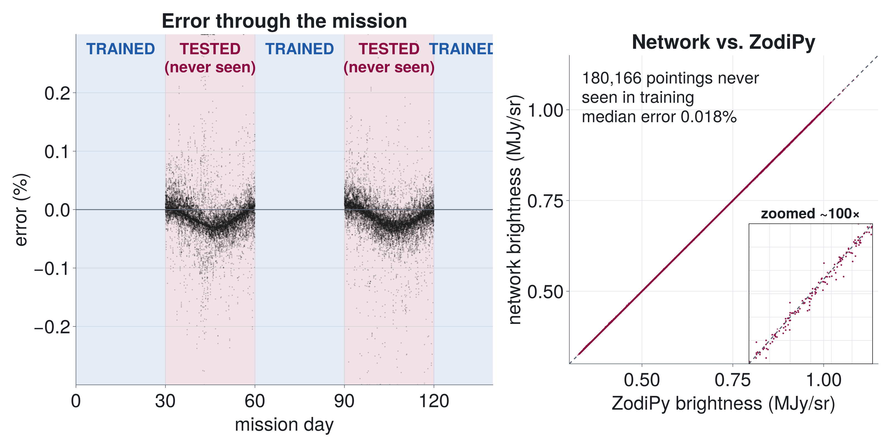
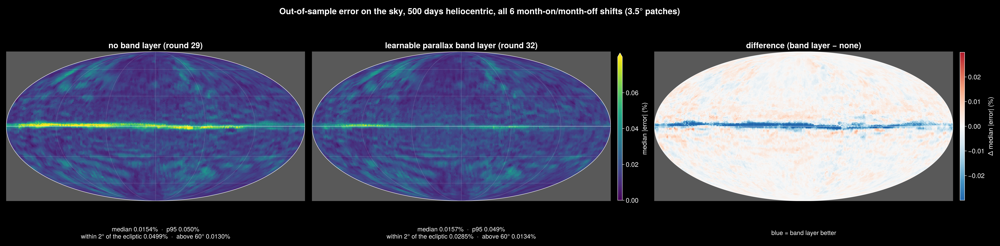

# Teaching a Neural Network the Glow of the Solar System

**A neural-network emulator of zodiacal light for NASA's SPHEREx mission**

Mark Burch (New Mexico State University), mentored by Dr. Andrew Saydjari.
Undergraduate Research Scholars (URS) research, part of New Mexico AMP, funded by the National Science Foundation (NSF).

Poster: *"Teaching a Neural Network the Glow of the Solar System: a geometrically constrained model of zodiacal light for
NASA's SPHEREx mission"*, presented at the NMSU URS Symposium, October 23, 2026 —
[PDF (light)](poster/poster_light.pdf) · [PDF (dark)](poster/poster_dark.pdf)

> **All results so far use simulated data.** The training targets are the Kelsall et al. (1998) zodiacal-light model as
> computed by [ZodiPy](https://github.com/Cosmoglobe/zodipy), evaluated along real SPHEREx pointings. The model has not
> yet been applied to real SPHEREx images.

## The problem

Zodiacal light is sunlight scattered and re-emitted by interplanetary dust. It is the brightest diffuse foreground in
SPHEREx's infrared all-sky survey, so it has to be modelled and subtracted from every exposure. Physical models such as
Kelsall's integrate a 3-D dust density along each line of sight. That is accurate but slow, and its fixed parameters can't
adapt to what SPHEREx actually sees. This project trains a small neural network that reproduces the model's 5 μm
brightness for any pointing and time, from inputs built out of the observing geometry.

## Method

* **Inputs: dot products of the pointing direction n̂ with physically meaningful directions.** These are the Sun, the
  ecliptic pole, Earth, the Sun's and Earth's velocities, and an Earth-longitude-rotated ecliptic frame, plus Earth's
  orbital phase (sin/cos λ⊕). They are computed in a Sun-centred (heliocentric) frame. Using the Sun's true position
  rather than the solar-system barycentre removed the need for a Jupiter input. The Sun sits 0.005–0.007 AU from the
  barycentre, pulled mainly by Jupiter, and the dust cloud moves with it; the network had been learning that offset
  indirectly through Jupiter's direction.
* **Network:** a 64-64-32-16 MLP with GELU activations (Julia + [Flux.jl](https://fluxml.ai)). Training uses Adam,
  batch size 512 and a one-cycle learning-rate schedule. Predictions average 5 networks with different random seeds.
* **Learnable dust-band layer (latest model).** Kelsall's asteroidal dust bands enter through a physics-shaped layer
  whose band inclinations, nodes, widths, shapes and distances (with parallax) are *trained* rather than fixed. The
  fitted values come out consistent across all 30 networks, near Kelsall's tilts (~1°).
* **Honest testing.** Training alternates whole months on and off ("month-on/month-off"), so every test pointing lies
  in a month the network never saw. The split is slid by 10-day steps (6 versions), so that every part of the sky and
  mission gets tested.

## Key results (5 μm, simulated data)

| model | data | median error | 95th percentile | within 2° of the ecliptic |
|---|---|---|---|---|
| poster model (Oct 2026) | 140 days, 423,607 pointings | 0.016% | 0.063% | 0.083% |
| heliocentric inputs | 500 days, 1,520,194 pointings | 0.015% | 0.050% | 0.050% |
| + learnable parallax dust-band layer | 500 days | 0.016% | 0.049% | **0.029%** |
| same, trained 2000 epochs instead of 500 *(in progress: 3 of 6 test splits)* | 500 days | **0.013%** | **0.036%** | **0.017%** |

All errors are |network − ZodiPy| / ZodiPy on months withheld from training. Sky maps combine all 6 shifted splits
except where noted.

*Left: error through the mission; only the shaded "tested" months were withheld from training. Right: network vs.
ZodiPy brightness for 180,166 withheld pointings (140-day data).*

*Out-of-sample error across the sky (500-day data). The learnable dust-band layer removes most of the error along the
ecliptic, where the dust bands are.*

Other checks (details in the notebooks):
* Removing Earth-direction inputs clearly hurts. The network does use them to model the dust ring around Earth's orbit
  and the cloud trailing Earth.
* A Jupiter-direction input and Earth-limb/Moon-direction inputs make no difference on simulated data, which is the
  correct "null" result. They are kept ready for real data.

## Repository layout

| path | contents |
|---|---|
| `zodi_setup.jl` | loads the pointing geometry, ephemerides and targets; selects the data set (`ZODI_DATA`) and frame (`ZODI_HELIO`) |
| `sweeps/` | training code (`mb_train.jl`, `band_layer.jl`, `extra_features.jl`), experiment configs (`configs_v*.jl`), the threaded runner (`run_threaded.jl`), analysis and plotting scripts, run logs |
| `notebooks/` | dated research notebooks (one per working day), indexed in [`notebooks/README.md`](notebooks/README.md) |
| `ZodiOnboarding.ipynb` | orientation notebook: data, inputs, model and results in one place |
| `zodipy_gen/` | Python scripts that generate the ZodiPy targets (and the Sun's barycentric positions) |
| `emulator/` | packaged emulator files with a self-contained Julia module and example ([`emulator/README.md`](emulator/README.md)) |
| `pipeline/` | feature pipeline for applying the model to new pointings, plus cluster scripts |
| `poster/` | poster source (`build_poster.py`, `make_figures.jl`), figures and the final PDFs/PPTX |
| `figures/` | figures produced along the way |
| `STATUS.md` | current project status |

## Reproducing

1. **Julia environment** (Julia 1.12): `julia --project=. -e "using Pkg; Pkg.instantiate()"`
2. **Data.** The HDF5 inputs (pointing geometry, ephemerides and targets) are not in this repository because of their
   size. The 140-day pointings and vectors came from the mentor's SPHEREx pipeline (listed with checksums in
   `data/MANIFEST.tsv`). The 500-day pointings are SPHEREx image metadata from IRSA. The ZodiPy targets are regenerated
   with `zodipy_gen/generate_500.py` (500-day data), using a Python environment with ZodiPy 1.1.5 and astropy.
3. **Train**, e.g. the learnable parallax-band model on all 6 month splits: set the environment variables
   `ZODI_DATA=z500`, `R31_STAGE=plx` and run
   `julia -t 5 --project=. sweeps/run_threaded.jl sweeps/configs_v31.jl` (the poster split), then again with
   `R31_STAGE=map` and `R31_WINNER=bandplx` (the other 5 splits). `sweeps/run_round31.ps1` chains these on Windows.
   Saved runs go to `sweeps/results_*/`, which is git-ignored because it is large.
4. **Analyse:** `sweeps/r24_data.jl` builds the out-of-sample sky maps; the notebooks show each analysis step.

## Acknowledgments

This research is supported by a URS grant at New Mexico State University (New Mexico AMP), funded by the National Science
Foundation. Thanks to Dr. Andrew Saydjari for mentorship, and to the developers of ZodiPy and Flux.jl.
